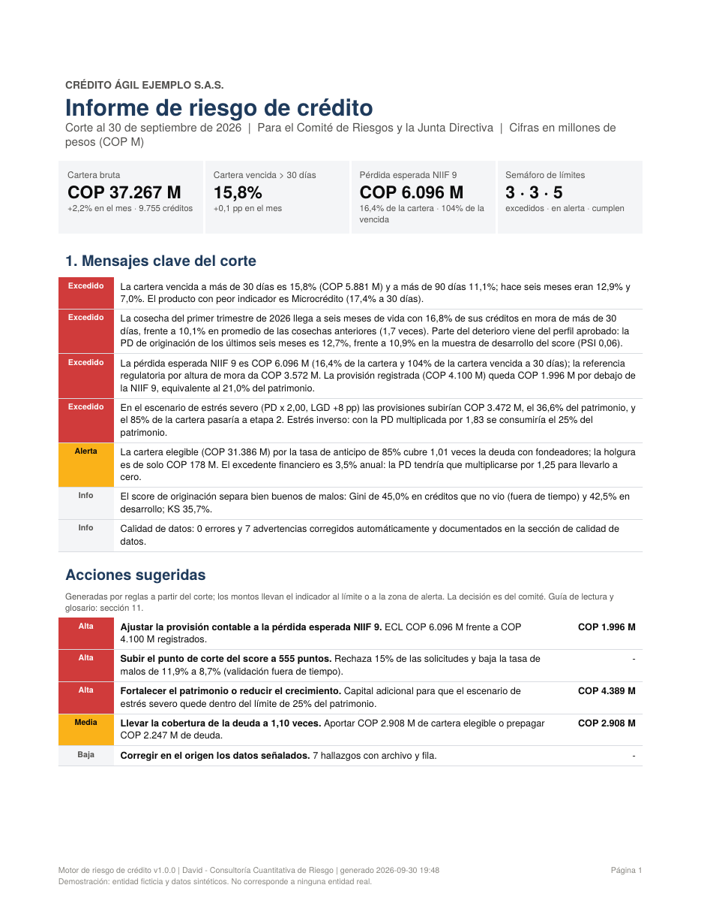
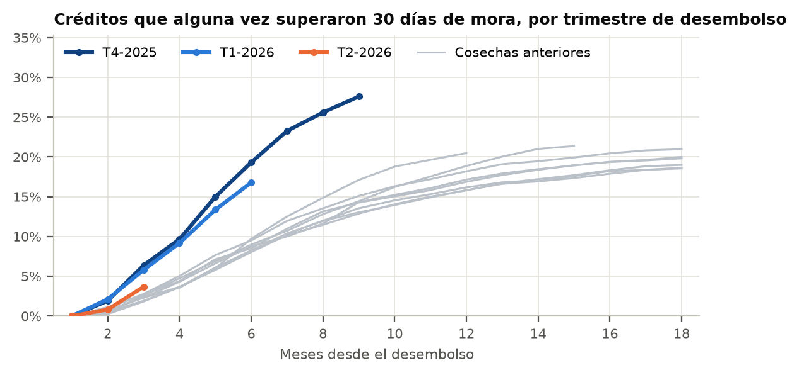
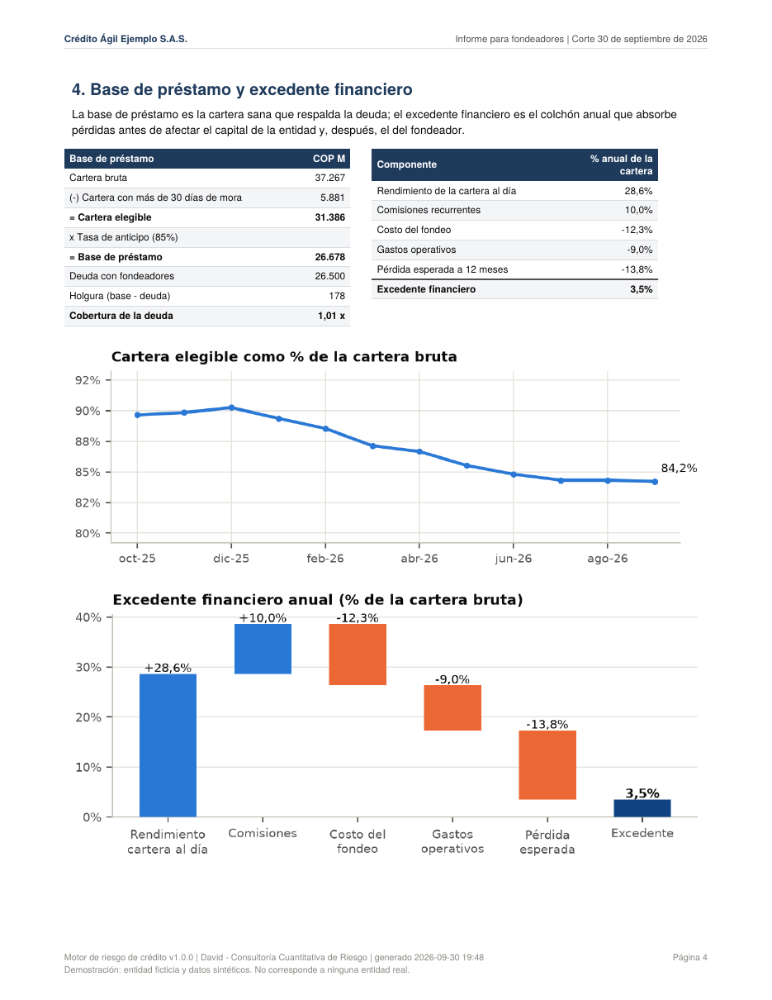

# Motor de riesgo de crédito para entidades pequeñas

> **In English:** A credit-risk engine for small lenders without an in-house
> quant team (credit fintechs, savings-and-credit cooperatives). From two plain
> files, loan originations and monthly performance, it builds an application
> scorecard (monotonic WoE binning, IV selection, IRLS logistic regression,
> points scaling, out-of-time Gini/KS, binomial calibration test, PSI). It then
> computes IFRS 9 expected credit losses: Markov roll-rate point-in-time PDs,
> lifetime PDs, LGD from discounted recovery curves, amortizing EAD, SICR
> staging and probability-weighted scenarios with the cliff effect. It compares
> those provisions with a Colombian-style days-past-due regulatory matrix,
> runs vintage and roll-rate analytics, stress and reverse stress tests, and a
> funding view (borrowing base, debt coverage, excess spread, break-even PD).
> The output is two PDFs from the same numbers, one for the risk committee and
> one for lenders/investors, plus an auditable Excel annex with live formulas.
> The demo uses two fictitious Colombian entities and synthetic data.



Las entidades de crédito pequeñas tienen la misma pregunta que un banco, sin un
equipo cuantitativo: **¿cuánto vamos a perder, estamos provisionando bien y
cuánto aguantamos si la cosa empeora?** El fondeador que les presta pregunta lo
mismo con otras palabras: **¿mi plata está cubierta?**

Este motor lee la historia de la cartera de la entidad y entrega, en segundos:

| Para | Entregable | Qué responde |
|---|---|---|
| Comité de riesgos y Junta | Informe de riesgo de crédito (PDF, 13 páginas) | Calidad de cartera, cosechas, score, provisiones NIIF 9 frente a la referencia regulatoria, estrés y acciones con montos |
| Fondeadores e inversionistas | Informe de cartera para fondeadores (PDF, 6 páginas) | Crecimiento, desempeño, base de préstamo, excedente financiero, estrés y punto de equilibrio |
| Auditoría y revisor fiscal | Anexo Excel (12 hojas) | Detalle por crédito y fórmulas vivas para rehacer cada total |

> La demostración trae dos entidades ficticias con datos sintéticos:
> **Crédito Ágil Ejemplo S.A.S.** (fintech de consumo digital y microcrédito) y
> la **Cooperativa de Ahorro y Crédito Ejemplo** (libranza, consumo y comercial
> pyme). Ninguna corresponde a una entidad real.

---

## Lo que encuentra en la demo

| | Fintech | Cooperativa |
|---|---|---|
| Cartera bruta | COP 37.267 M | COP 117.978 M |
| Cartera vencida a más de 30 días | 15,8% (10,3% hace un año) | 5,1% |
| Cosecha del primer trimestre de 2026 a seis meses (30+) | 16,8% frente a 10,1% histórico | 6,8% frente a 3,8% histórico |
| Gini del score, validación fuera de tiempo | 45,0% | 53,8% |
| Pérdida esperada NIIF 9 | COP 6.096 M | COP 5.635 M |
| Referencia regulatoria por altura de mora | COP 3.572 M | COP 4.213 M |
| Provisión registrada | COP 4.100 M (faltan COP 1.996 M = 21% del patrimonio) | COP 5.200 M (faltan COP 435 M) |
| Estrés severo: provisión adicional / patrimonio | 36,5% (límite 25%) | 14,0% |
| Cobertura de la deuda con la base de préstamo | 1,01 veces (holgura de COP 178 M) | 1,49 veces |
| Excedente financiero anual | 3,5% (cero si la PD sube 25%) | 4,4% |

**La historia de la fintech:** creció 29% en un año aprobando perfiles de menor
puntaje (la PD de originación pasó de 10,9% a 12,7%). Las cosechas recientes
llegan a seis meses con 1,7 veces más mora que las anteriores. La provisión
contable, hecha con una matriz por altura de mora, no ve el deterioro que la
NIIF 9 sí anticipa. Además, la base de préstamo apenas cubre la deuda. El motor
lo dice en la página 1 y propone acciones con montos:

- ajustar la provisión;
- subir el punto de corte del score a 555 puntos, lo que rechaza 15% de las
  solicitudes y baja la tasa de malos de 11,9% a 8,7%;
- aportar COP 2.908 M de cartera elegible;
- reforzar el capital.

**La historia de la cooperativa:** cartera sana y bien fondeada. La alerta es
la cosecha reciente, pero sin cambio en el perfil aprobado (PSI de 0,01): el
deterioro viene del entorno, no de la originación. La matriz regulatoria
subestima la pérdida de *comercial pyme* frente a su severidad real.



---

## Inicio rápido (Windows)

1. **Python 3.10 o superior** (python.org, marcando *Add python.exe to PATH*).
2. Descomprima la carpeta en `Documentos\riesgo-credito`.
3. Doble clic en **`instalar.bat`** (una sola vez).
4. Doble clic en **`demo.bat`**: crea las dos entidades de demostración,
   genera sus informes y abre la carpeta `salidas`.

Por comandos:

```
venv\Scripts\activate
python herramientas\generar_datos_demo.py
python generar_informes.py                      (todas las entidades)
python generar_informes.py --perfil fintech     (solo una)
python generar_informes.py --corte 2026-08-31   (un corte anterior)
```

## Qué se genera

```
salidas\
└── fintech\2026-09-30\
    ├── informe_comite_2026-09-30.pdf        13 páginas
    ├── informe_fondeadores_2026-09-30.pdf   6 páginas
    ├── anexo_credito_2026-09-30.xlsx        12 hojas
    └── graficas\                            9 gráficas en PNG
```

**Informe del comité:**
1. Resumen ejecutivo con mensajes y acciones
2. Límites y evolución
3. Cartera
4. Cosechas y rodamientos
5. Score de originación
6. Provisiones NIIF 9
7. Referencia regulatoria
8. Pruebas de estrés
9. Calidad de datos
10. Metodología y trazabilidad
11. Cómo leer el informe y glosario

**Informe para fondeadores:**
1. Tesis con fortalezas y riesgos
2. Originación
3. Desempeño
4. Base de préstamo y excedente financiero
5. Estrés y punto de equilibrio
6. Gestión del riesgo y advertencias



**Anexo Excel:**
- Hojas: Resumen, Creditos_NIIF9 (un registro por crédito), Provisiones,
  PD_LGD, Cartera, Cosechas, Rodamientos, Score, Fondeo, Estres,
  Calidad_datos y Parametros.
- Los totales por etapa, la provisión de referencia, la base de préstamo y el
  excedente financiero son fórmulas que apuntan al detalle por crédito.

---

## Estructura

```
riesgo-credito\
├── generar_informes.py         comando principal
├── instalar.bat / demo.bat / generar_informes.bat
├── plantilla\                  formato vacío para una entidad nueva
├── herramientas\generar_datos_demo.py
├── entrada\<entidad>\          (no se sube a GitHub)
│   ├── originaciones.csv       un registro por crédito
│   ├── desempeno.csv           un registro por crédito y mes
│   └── politica_credito.xlsx   límites, matriz regulatoria, escenarios, fondeo
└── credito\                    el motor
    ├── config.py               decisiones metodológicas
    ├── lectura.py              lectura, validación y bitácora de hallazgos
    ├── cartera.py              foto, evolución, cosechas, rodamientos, concentración
    ├── scoring.py              WoE, IV, logística IRLS, tarjeta de puntos, validación
    ├── niif9.py                PD (Markov), LGD (recuperaciones), EAD, etapas, ECL, matriz regulatoria
    ├── fondeo.py               base de préstamo y excedente financiero
    ├── estres.py               escenarios y estrés inverso
    ├── limites.py              indicadores y semáforo
    ├── narrativa.py            mensajes, acciones, fortalezas y riesgos
    ├── graficas.py · pdf_base.py · informe_comite.py · informe_fondeadores.py · anexo_excel.py
    └── proceso.py              orquesta todo
```

Guía de estudio del código, módulo por módulo: [docs/COMO_FUNCIONA.md](docs/COMO_FUNCIONA.md).

## Usarlo con una entidad real

1. Crear `entrada\<nombre>\` y copiar los tres archivos de `plantilla\`.
2. **originaciones.csv**:
   - Obligatorias: `id`, `fecha_desembolso`, `producto`, `monto`,
     `plazo_meses` y `tasa_ea`.
   - Variables de la solicitud que tenga la entidad: puntaje de buró,
     endeudamiento, ingreso, edad, antigüedad, vinculación, canal, región,
     garantía.
   - Si sus columnas se llaman distinto, se agregan como alias en
     `credito\config.py`.
3. **desempeno.csv**:
   - Columnas: `id`, `mes`, `saldo_capital`, `dias_mora`, `estado`
     (Vigente / Cancelado / Castigado) y `recuperacion_mes`.
   - Normalmente sale del cierre mensual del software de cartera.
   - Se necesitan al menos 24 meses de historia: 12 de desempeño para el score
     y 12 de rodamientos.
4. **politica_credito.xlsx**:
   - Hoja *Entidad*: patrimonio, deuda, anticipo, costos, provisión
     registrada y **Modo demostración = No**.
   - Hoja *Limites*: los límites aprobados por la Junta.
   - Hoja *Matriz_provision*: los porcentajes de la norma aplicable
     (Superfinanciera o Supersolidaria).
   - Hoja *Escenarios*: los escenarios aprobados.
5. Correr `generar_informes.bat` y conciliar el primer corte con la
   contabilidad.

## Alcance y limitaciones

- La referencia regulatoria es una matriz por altura de mora configurable,
  **no** el modelo de referencia oficial de la Superintendencia. Los
  porcentajes de la demo son ilustrativos.
- No se modelan prepagos ni intereses causados en la EAD (supuesto
  conservador), reestructuraciones ni castigos parciales.
- La PD de vida usa riesgo mensual constante por año; el estrés de cobertura
  de la deuda supone 3 meses de deterioro acelerado.
- El informe apoya la gestión. No reemplaza los reportes regulatorios, el
  criterio del área de riesgos ni la debida diligencia de un fondeador.

Muestras:
- [informe del comité de la fintech](docs/muestra_comite_fintech.pdf)
- [informe para fondeadores de la fintech](docs/muestra_fondeadores_fintech.pdf)
- [informe del comité de la cooperativa](docs/muestra_comite_cooperativa.pdf)

---
David, consultoría cuantitativa de riesgo (Medellín). © 2026, todos los
derechos reservados: el código se publica para consulta; su uso comercial
requiere autorización del autor. Ver también `reporting-riesgo` (riesgos de
tesorería) y `diagnostico-cambiario` (riesgo cambiario para exportadores).
